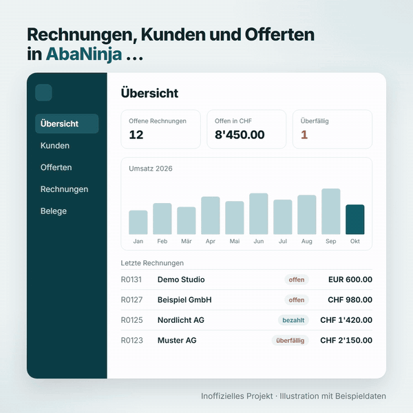

# abaninja-mcp

MCP-Server für [AbaNinja](https://www.abaninja.ch). Claude und andere KI-Assistenten greifen damit über die offizielle API auf ein AbaNinja-Konto zu. Inoffizielles Projekt.

<p align="center"></p>

## Installation

Zuerst in AbaNinja ein API-Token erstellen ([Anleitung](https://docs.abaninja.ch/guide/authentication.html)). Dem Token nur die nötigen Bereiche geben, denn AbaNinja kennt keine reinen Lese-Tokens. Nicht mehr gebrauchte Tokens in AbaNinja löschen.

### Claude Desktop

1. [abaninja-mcp.mcpb](https://github.com/ingeniumdesign/abaninja-mcp/releases/latest/download/abaninja-mcp.mcpb) herunterladen.
2. In Claude **Einstellungen → Erweiterungen → Erweiterte Einstellungen → Erweiterung installieren…** wählen und die Datei öffnen.
3. Installieren und das Token eintragen. Ein Neustart ist nicht nötig, nur falls die Tools fehlen.

### Claude Code

Braucht [Git](https://git-scm.com) und [Node.js](https://nodejs.org) ab 22. Im Terminal (in cmd `%CD%` statt `$PWD`):

```bash
git clone https://github.com/ingeniumdesign/abaninja-mcp.git
cd abaninja-mcp
npm ci
claude mcp add --scope user abaninja node "$PWD/dist/index.js" -e ABANINJA_API_TOKEN=dein-token
```

Danach `claude` neu starten. `/mcp` zeigt, ob AbaNinja verbunden ist. Aktualisieren: im Ordner `git pull` und `npm ci`.

### Andere MCP-Clients

`git clone` und `npm ci` wie oben, dann Befehl `node` mit Argument `<Ordner>/dist/index.js` (absoluter Pfad) eintragen, Token in `ABANINJA_API_TOKEN`.

## Benutzen

Einfach im Chat fragen, Claude nutzt AbaNinja dann selbst:

- «Welche Rechnungen sind noch offen?»
- «Zeig mir die letzten Offerten für die Müller AG.»

## Modi

Standard ist nur lesen. Mehr erlaubt `ABANINJA_MODE`, in Claude Desktop die Häkchen «Änderungen erlauben» und «Alles erlauben»:

| Modus | Erlaubt |
| --- | --- |
| `read` (Standard) | nur lesen |
| `write` | auch anlegen und ändern. Gesperrt bleiben: löschen, stornieren, versenden, mahnen, Sammelaktionen, Bankverbindungen, Webhooks, Import per URL |
| `full` | alles |

`write` schützt vor Versehen, nicht vor manipulierten Anweisungen in Daten oder Dokumenten. Sicher ist nur `read`.

Hat das Token Zugriff auf mehrere Konten oder fehlt ihm der Bereich `profile`, wählt `ABANINJA_ACCOUNT_UUID` das Konto.

## Tools

- `abaninja_search_addresses`: Kunden suchen nach Name, Nummer, E-Mail, Telefon oder Ort
- `abaninja_find_documents`: Rechnungen, Offerten, Gutschriften usw. finden
- `abaninja_open_invoices`: offene Rechnungen mit Summen pro Währung
- `abaninja_list_endpoints`, `abaninja_describe_endpoint`, `abaninja_request`: alle weiteren API-Endpunkte

Datei-Uploads sind nicht möglich. PDFs und andere Dateien zeigt der Server nur mit Typ und Grösse an.

## Entwicklung

```bash
npm test                  # Tests ohne Netz
npm run catalog           # Endpunkt-Katalog aus den OpenAPI-Specs neu erzeugen
npm run live              # Live-Test gegen ein echtes Konto (Token in .env), nur lesend
npm run live -- --write   # legt Testdaten an, ändert und löscht sie wieder
npm run bundle            # Erweiterung für Claude Desktop bauen
```

Release: [docs/release.md](docs/release.md)

Eigenheiten der API: [docs/abaninja-api.md](docs/abaninja-api.md)

## Haftungsausschluss

Dieses Projekt ist inoffiziell und steht in keiner Verbindung zur DeepCloud AG oder zur Abacus Research AG. «AbaNinja» ist eine Marke der jeweiligen Inhaberin.

Die Nutzung erfolgt auf eigene Verantwortung. Wer diesen MCP-Server einsetzt, handelt selbst und ist für alle Aktionen verantwortlich, die darüber ausgelöst werden. Das gilt insbesondere für angelegte oder geänderte Daten und Dokumente und deren Folgen. Von einer KI vorgeschlagene Änderungen sind vor der Verwendung zu prüfen.

Die Software wird ohne jede Gewähr bereitgestellt. Soweit gesetzlich zulässig, übernehmen die Autorinnen, Autoren und Herausgeber keine Haftung für Schäden, Datenverlust, fehlerhafte Buchungen oder Dokumente, die aus der Nutzung entstehen.

Für den Datenschutz ist die nutzende Person oder Organisation selbst verantwortlich, auch für die Verarbeitung von Kundendaten durch den angebundenen KI-Dienst.

## Lizenz

[MIT](LICENSE) © INGENIUMDESIGN
